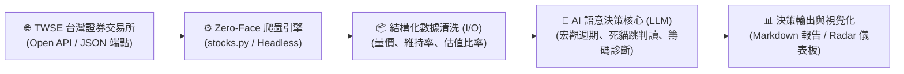
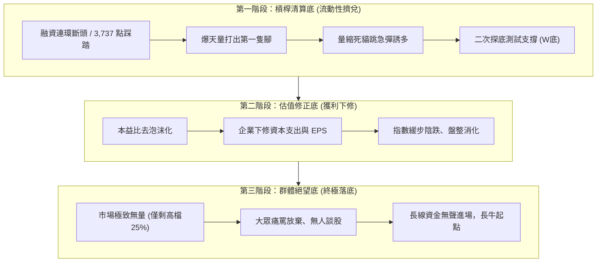

# 軟體工程 x 財務分析學習筆記：證券爬蟲與 AI 語意決策架構論

> **核心箴言**：  
> 「不背語法想流程，先定輸入與輸出；大題化小拆積木，指揮 AI 做驗收。」  
> 「GUI 是人類肉眼妥協的皮囊，Zero-Face 則是讓意圖直達數據本質的進化；最好的介面，就是感覺不到介面。」

---

## 🧭 一、核心架構哲學：為什麼是「爬蟲 + AI 語意分析」？

在傳統金融量化與投資決策中，分析師往往面臨兩大極端困境：
1. **純人工介面（GUI 的繁冗皮囊）**：投資人必須手動登入看盤軟體、在各種圖形介面與繁複分頁中點擊切換，肉眼辨識資訊效率低下，且容易受短期情緒干擾（如追高殺低、誤把死貓跳當反轉）。
2. **純代碼指標（Hard-coded 策略的死板僵化）**：傳統演算法交易依賴生硬的數值門檻（如 KD < 20 買進、突破均線放空），然而金融市場充滿了「語意情境」與「黑天鵝流動性踩踏」（例如 3,737 點暴跌、融資斷頭踩踏、空頭回補誘多）。傳統硬編碼程式碼無法理解「帶血的籌碼」、「量縮反彈代表籌碼真空」等複雜情境。

**解決方案**：
建立一套**「Zero-Face 無頭直取數據 ➔ 結構化特徵清洗 ➔ AI 大語言模型（LLM / Agent）深度語意推理」**的現代軟體工程管線（Pipeline）。



---

## 🧱 二、軟體工程第一步：I/O 思維與 Zero-Face 爬蟲實踐

依據「架構師四步法」，任何軟體模組的第一要務是**先定輸入（Input）、輸出（Output）與處理邊界（Process）**。

### 1. 脫殼直取（Headless First & Pure API）
捨棄龐大且容易變更的網頁渲染 DOM 結構，直探交易所後台的官方 JSON API 端點：
- **大盤加權指數 (`FMTQIK`)**：`https://www.twse.com.tw/rwd/zh/afterTrading/FMTQIK`
- **個股日成交資訊 (`STOCK_DAY`)**：`https://www.twse.com.tw/rwd/zh/afterTrading/STOCK_DAY`
- **個股本益比、殖利率、淨值比 (`BWIBBU`)**：`https://www.twse.com.tw/rwd/zh/afterTrading/BWIBBU`

### 2. 邊界防守與雙層保底（Two-Tier Fallback）
在 [stocks.py](file:///D:/code秋季115/week_10/project_stocks/stocks.py) 的工程設計中，必須處理解析過程的天然邊界問題：
* **跨月滑窗機制（Cross-Month Sliding Window）**：月初時當月交易天數不足 `data_num` 筆，爬蟲模組必須具備時間倒推邏輯，自動跨年至前一年 12 月拼接資料。
* **反爬蟲與請求頻率防護**：偽裝標準 `User-Agent`，在各批次 API 呼叫間植入 `time.sleep(0.5)`，避免觸發 TWSE 429 或封鎖。
* **零殭屍程序與超時防護**：所有 HTTP 呼叫一律加入 `timeout=10`，杜絕連線懸掛。

```python
# 核心模組化積木：脫殼取得純數據
def fetch_twse_json(endpoint: str, params: dict) -> dict:
    headers = {'User-Agent': 'Mozilla/5.0 (Windows NT 10.0; Win64; x64)'}
    try:
        response = requests.get(endpoint, params=params, headers=headers, timeout=10)
        if response.status_code == 200:
            return response.json()
    except requests.RequestException as e:
        logger.error(f"連線失敗: {e}")
    return {}
```

---

## 🧠 三、AI 財務分析的理論本質：從數值到「語意情境」

AI 大語言模型在財務分析中扮演的不是「計算機」，而是**「全維度金融情境解讀者」**。

### 1. 數值與金融語意的鴻溝（The Numeric-Semantic Gap）
| 傳統數值觀察 | AI 語意推理與決策情境 |
| :--- | :--- |
| 台積電大漲 100 元 (+4.7%) | ⚠️ **量縮 -58.5% 的死貓跳（Dead Cat Bounce）**。此為 11/06 暴跌 105 元爆 11 萬張天量後，賣盤洗淨導致的籌碼真空急彈，上方 2,300~2,350 元仍有 5,000 億套牢籌碼，切勿追高。 |
| 單日成交金額爆出 1.32 兆元 | 💥 **極端恐慌拋售高潮（Selling Climax）**。全市場維持率跌破 130% 引發槓桿踩踏，同時亦有超級大戶/國家隊在低檔承接，確立第一隻腳。 |
| 本益比降至 24.7 倍、殖利率 1% | 🛡️ **估值去泡沫化完成第一階段**。脫離 28 倍以上的本夢比區間，具備中長線左側交易分批進場的價值防護邊界。 |

### 2. Prompt 工程與情境注入（Prompt Context Engineering）
要讓 AI 做出客觀且具備架構師深度的財務分析，不能只給「今天跌 300 點怎麼看？」，必須注入四層完整架構：
1. **宏觀大週期定位（System Paradigm）**：告知目前處於去槓桿三階段的哪一階段（如流動性擠兌底、估值修正底、群體絕望底）。
2. **量價微觀事證（Micro Evidences）**：餵入連續數日的高低價、量能增減百分比、成交筆數。
3. **籌碼與心理錨定（Psychological Anchoring）**：融資維持率、跌停鎖死家數、歷史套牢區間。
4. **輸出強制規範（Output Format）**：強制遵循「定性 ➔ 量價拆解 ➔ 關鍵反壓/支撐 ➔ 實戰禁忌」結構輸出。

---

## 📈 四、實戰方法論：去槓桿三階段決策模型

透過「爬蟲 + AI」，我們能將市場走勢精準對齊到金融大週期模型：



---

## 🛠️ 五、軟體工程最佳實踐（Best Practices）

在開發證券爬蟲與 AI 金融分析專案時，必須牢記以下工程守則：

1. **模組解耦（Decoupling）**：
   - `stocks.py` 專注於 **I/O 與數據擷取**（單一職責）。
   - 分析引擎（如 `analysis_engine.py` 或 AI 提示詞腳本）專注於 **語意組裝與推理**。
   - 前端視覺化（如 `index.html`）專注於 **狀態燈號與用戶交互**。
2. **零硬編碼與金鑰安全**：
   - 所有的 API Key、密碼、Token 嚴格隔離於 `.env` 中，Git 提交一律排除。
3. **客觀驗收大於主觀預測**：
   - AI 是輔助理性分析的鏡子，而非預測未來的占卜水晶球。
   - 永遠以「全市場融資減額是否達 30%」、「維持率是否連續 3 日穩在 145%」、「跌停家數是否 < 5」等**客觀事證（Evidences）**作為最終簽核結案的標準。

---

## 📚 六、專案關聯與延伸閱讀

- 📊 **專案實作程式碼**：[week_10/project_stocks/stocks.py](file:///D:/code秋季115/week_10/project_stocks/stocks.py)
- 🖥️ **第一階段觀察儀表**：[大去槓桿事證雷達/index.html](file:///D:/code秋季115/大去槓桿事證雷達/index.html)
- 📋 **落底指標檢驗表**：[大去槓桿事證雷達/docs/第一階段_槓桿清算底_詳細檢查表.md](file:///D:/code秋季115/大去槓桿事證雷達/docs/第一階段_槓桿清算底_詳細檢查表.md)
- 🔬 **個股實戰分析案例**：[大去槓桿事證雷達/docs/深度結構性分析_2330.md](file:///D:/code秋季115/大去槓桿事證雷達/docs/深度結構性分析_2330.md)
- 📝 **每日觀察手記**：[大去槓桿事證雷達/docs/2026-11-10_今日觀察重點筆記.md](file:///D:/code秋季115/大去槓桿事證雷達/docs/2026-11-10_今日觀察重點筆記.md)

---

### ⚖️ 法律聲明與風險揭露 (Disclaimer)
本文件為軟體工程資料擷取（API 爬蟲）與人工智慧語意推理之學術技術探討，文中所涉及之金融市場名詞、情境模擬與個股案例均為示範研究，不代表任何形式之證券投資建議。市場操作有其固有風險，投資人應獨立判斷並自負盈虧。
